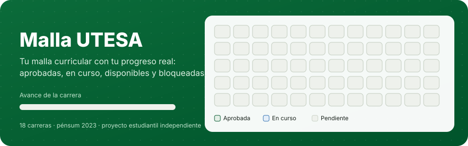
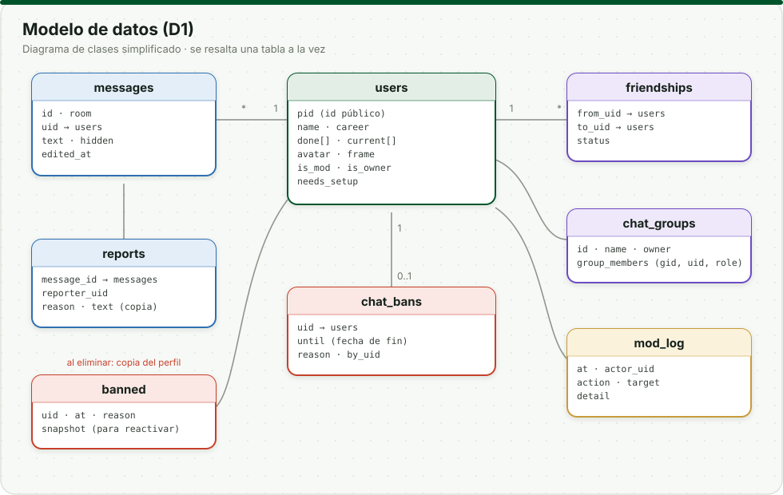

<p align="center">
  
</p>

<p align="center">
  <a href="https://malla-utesa.pages.dev"></a>
  
  
  
</p>

<p align="center">
  <b>Malla curricular interactiva para estudiantes de UTESA</b> · 18 carreras · pénsum 2023<br>
  <sub>Proyecto estudiantil independiente. <b>No es un sitio oficial de UTESA</b> ni está afiliado a la universidad.</sub>
</p>

---

## Qué es

**Malla UTESA** muestra la malla curricular de cada estudiante **con su progreso real**: qué materias aprobó, cuáles cursa ahora,
cuáles puede inscribir y cuáles siguen bloqueadas por requisitos. El avance se marca a mano o se trae del portal de UTESA
con un clic, y alrededor hay una comunidad moderada para estudiar juntos.

| | |
|---|---|
| 🗺️ **Malla interactiva** | Mapa por cuatrimestres con la ruta de requisitos, zoom, tarjetas y filtros (aprobadas, pendientes, **en curso**, electivas). |
| 🔗 **Vinculación con UTESA** | Inicio de sesión directo o **marcador**: trae pendientes, inscritas y contadores. La contraseña solo vive en memoria. |
| 📊 **Gráficos y proyección** | Avance por cuatrimestre, ritmo frente al plan y cuándo terminarías según los créditos que tomes (hasta el máximo de tu pénsum). |
| 🖨️ **Hoja imprimible** | Una página carta con el formato clásico de malla (HT · HP · TH · CR, flechas de requisitos) coloreada con tu avance. |
| 🎨 **Personaje y temas** | Creador de avatares en SVG (22 cortes, 12 estilos de barba, ropa de temporada…), marcos por logros y 6 temas. |
| 💬 **Comunidad** | Chat general y por carrera, amigos, chats privados y grupos con sus propios administradores. |
| 🛡️ **Moderación** | Panel del equipo: cuentas, reportes, suspensiones por tiempo, reinicio de cuentas, eliminadas reactivables y registro. |

## Cómo funciona

> Los diagramas son SVG animados en bucle (se generan con `node tools/build-diagrams.mjs`).

### Arquitectura

<p align="center"></p>

* **Sitio estático** en Cloudflare Pages: HTML, CSS y JavaScript nativo (módulos ES), sin paso de build.
* **API** en un único Worker (`app/_worker.js`, sin dependencias): verifica el token de Firebase (RS256), aplica permisos, límites y moderación.
* **D1** (SQLite) guarda perfiles, avance, chat y moderación. **Firebase** se usa solo para iniciar sesión y para avisos en vivo sin contenido.
* El **portal de UTESA** solo se lee, y únicamente cuando el estudiante lo pide.

### Vinculación con UTESA

<p align="center"></p>

El avance se calcula como **pénsum − asignaturas pendientes**; las **inscritas** se marcan como *en curso*.
El estudiante revisa la lista antes de guardar. Con el **marcador**, todo ocurre en su propio navegador y no pasa ninguna contraseña por el servidor.

### Estados de una materia

<p align="center"></p>

### Modelo de datos

<p align="center"></p>

Nunca se expone el `uid` de Firebase ni el correo de nadie: entre usuarios todo viaja con un **id público** (`pid`).

### Moderación

<p align="center"></p>

## Tecnología

| Capa | Tecnología | Por qué |
|---|---|---|
| Interfaz | HTML + CSS + JavaScript nativo | Sin build ni dependencias: carga rápido y cualquiera puede leer el código. |
| API | Cloudflare Worker (un archivo) | Gratis, global y con el mismo dominio que el sitio. |
| Datos | Cloudflare D1 (SQLite) | Consultas SQL atómicas (límites y topes sin condiciones de carrera). |
| Identidad | Firebase Auth | Inicio de sesión con correo o Google; el servidor verifica cada token. |
| Tiempo real | Firestore (solo «avisos») | Los mensajes viven en D1; Firestore solo avisa que hay algo nuevo. |
| Despliegue | GitHub → Cloudflare Pages | Cada merge a `main` se publica solo; cache-busting por commit. |

## Pruébalo en tu computador

Necesitas **Node.js 22.5 o superior** (recomendado 24). No hay nada que instalar: el proyecto no tiene dependencias.

```bash
git clone <URL-de-este-repositorio>
cd malla-utesa
npm run dev        # http://localhost:5190 — elige un usuario de prueba en /dev.html
npm test           # 8 suites, más de 420 comprobaciones
npm run check      # sintaxis de todo el JavaScript + escaneo de secretos
```

`npm run dev` levanta la app completa **sin Cloudflare, Firebase ni cuentas**: corre el Worker real contra SQLite en memoria,
con Firebase simulado y un portal de UTESA falso. Detalles en [`docs/TESTING.md`](docs/TESTING.md).

## Calidad y seguridad

* **Pruebas automáticas** contra el Worker real: permisos, límites, moderación, vinculación, filtro de lenguaje, cabeceras,
  compatibilidad de avatares (más de 12 000 combinaciones) y la hoja impresa para las 18 carreras.
* **CI** en cada Pull Request (`check-and-test`).
* **Auditorías de seguridad** periódicas; cabeceras estrictas (CSP completa, `X-Frame-Options`, `nosniff`).
* **Privacidad por diseño:** la contraseña de UTESA nunca se guarda; de las páginas del portal solo se toman las claves de materias;
  sin `uid` ni correos entre usuarios. Ver [`docs/PRIVACY-AND-DATA.md`](docs/PRIVACY-AND-DATA.md) y [`SECURITY.md`](SECURITY.md).

## Estructura

```
app/                  lo único que se publica (Cloudflare Pages)
  _worker.js          API completa: un solo archivo, sin dependencias
  *.html  js/  css/   páginas y módulos ES nativos (sin build)
docs/                 arquitectura, API, datos, despliegue, privacidad, hoja de ruta + diagramas (docs/img)
tests/                pruebas del servidor contra el Worker real
tools/                servidor de desarrollo, generación de datos y de diagramas, revisión de secretos
firebase/             reglas de Firestore
```

## Flujo de trabajo

```
 rama ──► Pull Request ──► CI (revisión + pruebas) ──► merge a main ──► despliegue automático
```

Guía para colaborar en [`CONTRIBUTING.md`](CONTRIBUTING.md). Si trabajas con una IA, pásale [`AGENTS.md`](AGENTS.md)
(plantillas en [`docs/AI-WORKFLOW.md`](docs/AI-WORKFLOW.md)).

## Documentación

| Documento | Contenido |
|---|---|
| [`docs/ARCHITECTURE.md`](docs/ARCHITECTURE.md) | Cómo funciona por dentro |
| [`docs/API.md`](docs/API.md) | Todas las rutas de `/api/*` |
| [`docs/DATA-MODEL.md`](docs/DATA-MODEL.md) | Tablas de D1, Firestore y salas del chat |
| [`docs/FEATURES.md`](docs/FEATURES.md) | Qué hace la app, función por función |
| [`docs/DEPLOY.md`](docs/DEPLOY.md) | Cloudflare Pages conectado a GitHub, build y reversa |
| [`docs/TESTING.md`](docs/TESTING.md) | Pruebas y entorno local |
| [`docs/PRIVACY-AND-DATA.md`](docs/PRIVACY-AND-DATA.md) | Qué datos se guardan y riesgos conocidos |
| [`docs/ROADMAP.md`](docs/ROADMAP.md) | Ideas y trabajo pendiente |
| [`docs/CHANGELOG-FEATURES.md`](docs/CHANGELOG-FEATURES.md) | Historia de funciones y decisiones |
| [`SECURITY.md`](SECURITY.md) | Secretos, qué es público y cómo reportar fallos |

## Aviso

Los datos de los pénsums se transcribieron de los documentos publicados por UTESA, en parte con ayuda de herramientas de
inteligencia artificial, y se revisaron con comprobaciones automáticas. Pueden contener errores: **confirma siempre tu avance
con tu coordinación de carrera**. Los errores se pueden reportar desde la propia app.

**Autor:** Emil Enmanuel Mercedes Francisco · Ingeniería en Sistemas Computacionales.
Reportes y sugerencias: botón de contacto dentro de la app.
